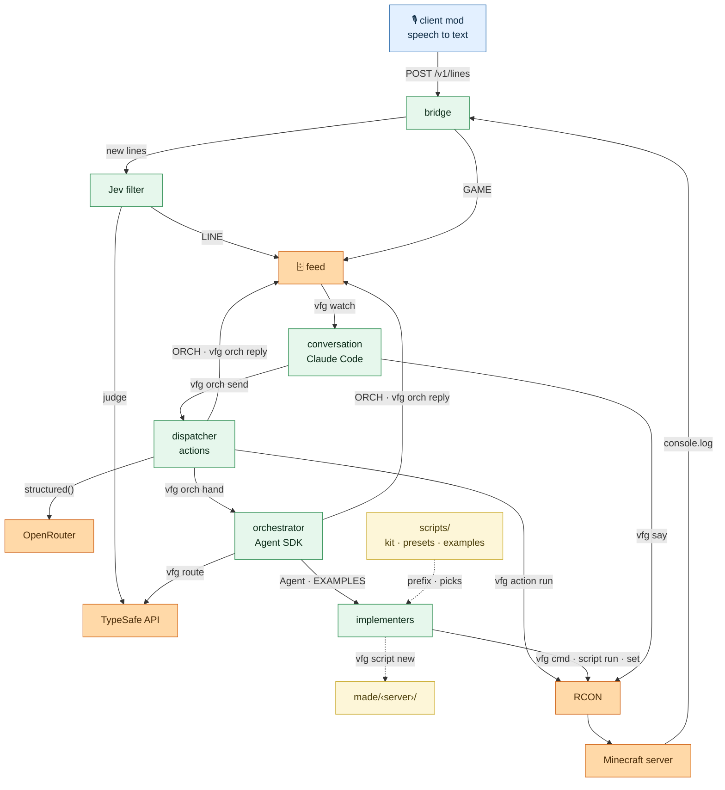

# Everhear

Everhear is an AI that plays Minecraft with you. It listens to what players say into their mics or
type in chat, answers in chat, and changes the game for them: builds, mobs, events, minigames.

The code still carries its working name, `vfg`, in commands, folders and settings.

## How it works



*Legend: read top-down, from a player's voice to the game. Blue runs on each player's PC; green is
Everhear's own services; orange is data, the game and third parties; yellow is the script library
and the server's own folder. Solid arrows are live calls; dashed ones hand over files: the library
goes into each implementer's context, and what it makes goes into `made/`. Every arrow joins two
top-level boxes.*

- The **client mod** turns speech into text on the player's own PC (no audio leaves it) and posts
  each line to the **bridge** on the server's EC2 box. The bridge also tails the Minecraft console
  for joins, deaths and the like.
- The **Jev filter** asks Jev (TypeSafe) whether each line is said to the AI, useful context, or
  noise, and writes what it keeps to the **feed**, one line per entry, beside the bridge's game
  events.
- The **conversation** is a Claude Code session on the owner's PC that follows the feed over SSH
  (`vfg watch`). It answers in chat at once, stays quiet, or sends the work on with `vfg orch send`.
- The **dispatcher** gets every task first. It does simple asks at once as **actions** (items,
  effects, teleports, saved places), choosing them with a fast OpenRouter model, and hands the rest
  to the **orchestrator** with `vfg orch hand`.
- The **orchestrator** briefs **implementers** (subagents) for every task it is handed, and runs
  no command itself. Each brief goes out with the scripts and presets Jev picks for the job
  (`vfg route`), whole, and the server's state. Implementers act through RCON: they run a script
  from the library, change its values while it runs, or copy presets into a new script with
  `vfg script new` in `made/<server>/`. The library in `scripts/` is read-only during play.
- Both report as `ORCH` lines in the feed, and the conversation tells the player.
- Everything on the owner's PC reaches the box through one command, [`vfg`](toolkit/README.md).

What each part takes in and puts out is in [docs/CONTRACTS.md](docs/CONTRACTS.md); code comments cite it as "Contracts §N".

## The parts

| Folder | What it is |
|---|---|
| [`client-mod/`](client-mod/README.md) | the Fabric mod players install: mic, speech to text, posting lines |
| [`installer/`](installer/README.md) | one link for players that installs Fabric, the mod and today's server |
| [`bridge/`](bridge/README.md) | on the box: the speech endpoint, the console tail, the feed; `deploy/` launches, provisions and retires the box |
| [`jev/`](jev/README.md) | on the box: the Jev filter |
| [`toolkit/`](toolkit/README.md) | `vfg`, and [`config.example`](toolkit/config.example), every setting with its default |
| [`conversation/`](conversation/README.md) | the Claude Code session: [`CLAUDE.md`](conversation/CLAUDE.md) is its whole brief, `start` runs it |
| [`dispatcher/`](dispatcher/README.md) | every task's first stop: does simple asks at once as actions, in seconds, and hands the rest to the orchestrator |
| [`actions/`](actions/README.md) | what the dispatcher can run on the server: one pydantic class per folder, a handler where commands cannot do the job |
| [`orchestrator/`](orchestrator/README.md) | the Agent SDK runner, its [prompts](orchestrator/prompts/) and its guard |
| [`scripts/`](scripts/README.md) | the script library: the kit every script imports, presets copied into scripts, and example scripts implementers run or copy |
| `made/` | what implementers make during play, one folder per server (`VFG_SERVER`); gitignored |
| [`lib/py/`](lib/py/vfg_llm.py) | `structured()`: the one OpenRouter call every part makes for a validated pydantic answer |
| [`integration/`](integration/README.md) | the bridge, Jev filter and toolkit run together on one PC, no EC2; [`realmc/`](integration/realmc/README.md) runs real 26.3 servers with fake players, [`replay/`](integration/replay/README.md) replays a playtest's tasks |

## Requirements

- An AWS account, and the AWS CLI v2 logged in to it.
- Claude Code, logged in with a Claude subscription, and [uv](https://docs.astral.sh/uv/) for the
  dispatcher's and the orchestrator's Python. Neither the conversation nor the orchestrator runs on an API key.
- A TypeSafe API key, for Jev.
- An [OpenRouter](https://openrouter.ai) API key, for the dispatcher.
- Minecraft Java 26.3 with Fabric, for every player (the installer sets Fabric up).
- Python 3.9 or newer, bash, ssh, rsync and curl on the owner's PC.
- JDK 25 to build the mod (Gradle downloads one if there is none).

## Quick start

From the repo's root. Every setting lives in `~/.vfg/config`; its defaults are in
[`toolkit/config.example`](toolkit/config.example).

```sh
# 0. Once: vfg on the PATH, and ~/.vfg/config from config.example.
toolkit/install.sh
# Fill VFG_OWNER (your Minecraft name) and VFG_SSH_KEY. Read Minecraft's EULA
# (https://aka.ms/MinecraftEULA) and, if you accept it, set VFG_ACCEPT_EULA=true.
# The dispatcher's OpenRouter key, alone in ~/.vfg/openrouter.key with mode 600, typed at a
# hidden prompt (VFG_OPENROUTER_KEY in ~/.vfg/config can point at another file):
(umask 077 && read -rsp 'OpenRouter key: ' key && echo && printf '%s\n' "$key" > ~/.vfg/openrouter.key)

# 1. Once: the EC2 key pair (VFG_KEY_PAIR, default everhear) in VFG_AWS_REGION (default us-east-2).
aws ec2 create-key-pair --region us-east-2 --key-name everhear \
  --query KeyMaterial --output text > ~/.ssh/everhear.pem
chmod 600 ~/.ssh/everhear.pem       # and set VFG_SSH_KEY=~/.ssh/everhear.pem

# 2. Launch the box. It prints its IP: put it in ~/.vfg/config as VFG_SSH_HOST.
bridge/deploy/ec2.sh launch

# 3. Provision Java and Minecraft. --restore brings back the world ec2.sh retire saved.
bridge/deploy/deploy.sh provision          # or: bridge/deploy/deploy.sh provision --restore

# 4. Deploy the bridge, then the Jev filter.
bridge/deploy/deploy.sh
jev/deploy.sh

# 5. The secrets, typed at a hidden prompt (once: --restore keeps them).
python3 -c "import secrets; print(secrets.token_urlsafe(32))"   # a client token to paste
bridge/deploy/set-secret.sh VFG_CLIENT_TOKEN
bridge/deploy/set-secret.sh TYPESAFE_API_KEY

# 6. Build the mod and publish the installer link; send the link it prints to your players.
(cd client-mod && ./gradlew build)
installer/publish.sh

# 7. Start the conversation. It brings the server up, arms the watch and starts the orchestrator.
conversation/start

# 8. Play: players run the installer, pick "VFG 26.3" in the launcher, join "VFG",
#    press K to pick a mic, and talk. Type "stop" in the conversation to sign the AI off.

# 9. Retire: back the world up into VFG_BACKUP_DIR, check it, terminate the box.
bridge/deploy/ec2.sh retire
```

The box's IP changes on every launch and every stop and start: update `VFG_SSH_HOST` and run
`installer/publish.sh` again for a new link. When your own IP changes, `bridge/deploy/ec2.sh ssh-ip`
moves the SSH rule to it. `bridge/deploy/ec2.sh stop`, `start` and `status` pause and resume a box
without retiring it.

## Costs

Rough guidance from list prices; check the current ones for your region and plan.

| What | How it is billed |
|---|---|
| EC2 | `m7i.xlarge` on demand, about $0.20 an hour while running, plus a 30 GB gp3 disk until the box is retired. `ec2.sh stop` stops the hourly charge; `retire` ends both |
| Jev (TypeSafe) | per call, one per line players say or type; see TypeSafe's pricing |
| Claude | the conversation, the orchestrator and implementers run on a Claude subscription and count against its usage limits. At API prices they would be the largest cost by far, since every turn rereads a long cached context; `vfg usage add` records each part's tokens and their API-price cost in the `usage` table |
| S3 | the installer bucket holds a few MB, deleted after 8 days |

## Safety

- **Players ask; they do not command.** Only the owner (`VFG_OWNER`) may ask for op or deop, kicks,
  bans, the whitelist, gamemode, difficulty or gamerule changes, stopping the server or resetting
  the world. A line claiming to speak for the owner counts as the player who said it.
- **The conversation only talks.** Its settings deny it `vfg cmd`, `vfg script`, `vfg orch reply`,
  file edits, web access and subagents; everything that changes the game is handed off.
- **The orchestrator's guard** ([`orchestrator/orchestrator/guard.py`](orchestrator/orchestrator/guard.py)),
  a hook on every tool call, and its allow rules (`rules` in
  [`orchestrator/orchestrator/session.py`](orchestrator/orchestrator/session.py)) refuse:
  - `stop`, `op`, `deop`, `ban`, `ban-ip`, `pardon`, `pardon-ip`, `whitelist`, `kick` and `save-off`
    in any `vfg cmd`, as the first word or after any `run`, however the command is chained.
    Those are the owner's to type, and `scripts/_lib/mc.py` refuses the same words in every script.
  - for implementers, server-wide settings: `setworldspawn`, `defaultgamemode`, `difficulty` and
    `worldborder`;
  - for the orchestrator itself, every command but `vfg script list` and `vfg place list`: it
    briefs implementers and runs nothing;
  - for implementers, any shell command but `vfg`'s own, `python3 -m py_compile`, `sleep`, `echo`,
    and `ls`, `grep`, `head` and `tail` on files in the repo; `vfg` may be piped into `head`,
    `tail` or `grep`; no `$( )`, backtick, variable, loop or redirection into a file;
  - reading or searching outside the repo; writing anywhere but `made/<server>/`, so the library
    never changes during play; and editing a made script another task's instance is running.
- **The box:** RCON answers on loopback only, SSH only from the owner's IP; the game (25565) and the
  bridge (8787) are open. The client token in the installer only lets someone post speech lines.

## Status

An early prototype, run by a few friends on one server. Expect rough edges.

## License

[MIT](LICENSE). The mod bundles sherpa-onnx, under the Apache License 2.0
([`client-mod/LICENSE-sherpa-onnx.txt`](client-mod/LICENSE-sherpa-onnx.txt)).
