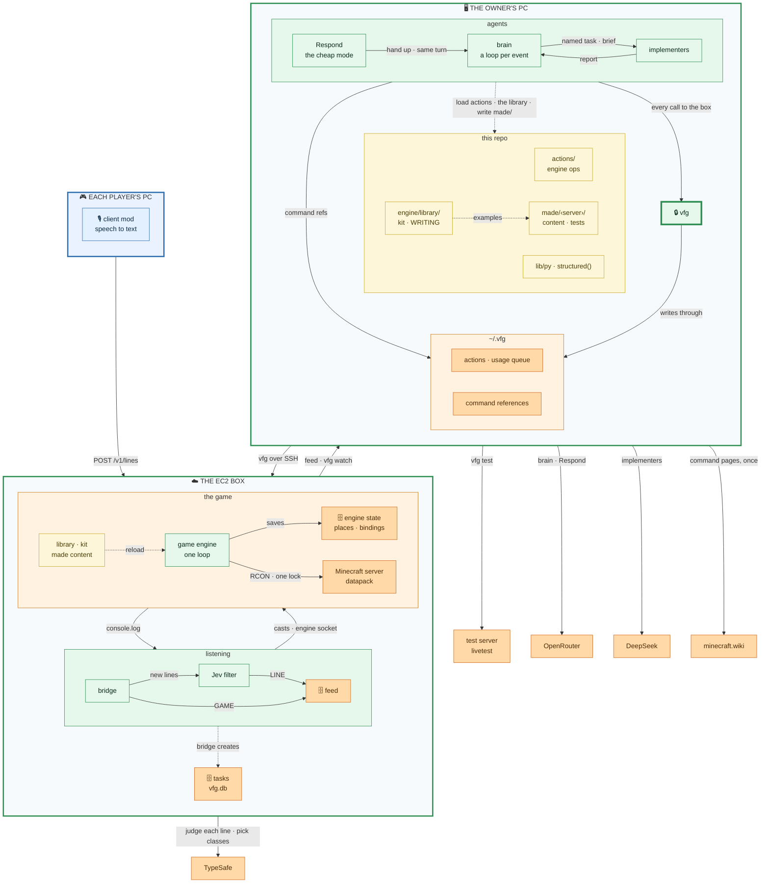

# Everhear

Everhear is an AI that plays Minecraft with you. It listens to what players say into their mics or
type in chat, answers in chat, and changes the game for them: builds, mobs, events, minigames.

The code still carries its working name, `vfg`, in commands, folders and settings.

## How it works



*Legend: read top-down, from a player's voice to the game. The three big boxes are the machines everything runs on; an arrow between two of them stands for every call that crosses, with the contract on its label. Blue runs on each player's PC; green is Everhear's own services; orange is data, the game and third parties; yellow is code and classes the agents load or write. Solid arrows are live calls; dashed ones load, write or create files and tables. An arrow only joins two boxes with the same parent. `vfg` is drawn on its own because every call from the owner's PC to the box goes through it.*

- The **client mod** turns speech into text on the player's own PC (no audio leaves it) and posts
  each line to the **bridge** on the server's EC2 box. The bridge also tails the Minecraft console
  for joins, deaths and the like.
- The **Jev filter** asks Jev (TypeSafe) what should become of each line: the brain acts on it
  (`action_oriented`), Respond answers it (`conversational`), it is kept as context, or it is
  dropped. A line for the brain or Respond goes with its speaker's earlier lines that belong to the
  same ask, which a second Jev call gathers. It writes what it keeps to the **feed**, one line per
  entry, beside the bridge's game events.
- The **brain**, on the owner's PC, follows the feed over SSH (`vfg watch`). Every action-oriented
  line is a loop of steps, each one call to an OpenRouter model (`structured()`, Gemini 3.8 Flash).
  A step runs **actions** written in full, each one of the game engine's operations (start a
  scenario with its args: a command, a teleport, a castle, a horde; give an item, grant an ability,
  apply a mark, bind a phrase, change a class's numbers), together or in turn, and writes the
  player's reply with them: when every action lands, the reply goes out and the loop is done in one
  step; when one does not land, its result comes back and the next step fixes it. A step can also
  read another player's items or a class's Config, stop what runs, hand something new off to an
  implementer under a task's name (`galick_gun_styrk`) with a brief in parts, or follow a task up
  or cancel it. Each task is a row in the box's `vfg.db`, which only
  the brain writes.
- **Respond**, the brain's cheap mode, answers a conversational line on a cheaper model, or hands it
  up to the brain when it asks for something to happen.
- **One turn per player**: a player's lines run one at a time, whichever of the two takes them,
  while different players' run at once. At most three wait (`VFG_TURN_WAITING`); one more is turned
  away with a private message, and an implementer's report goes to the front.
- **Implementers** are started by code from the brain's brief, one per task, each with the engine
  classes Jev picks for the job (`vfg route`), whole, and the server's state. They use what the
  engine has (start a scenario, grant, give, apply, bind) or write one new class in
  `made/<server>/content/`, named after their task, test it on a test server of its own (`vfg
  test`), and report to the brain, which tells the player. The library (`engine/library/`) and the
  actions are read-only during play.
- The **shared context** is the feed itself: every kept line, every game event and what the brain
  did, in order, read whole at the start of every loop and by every Respond call; the lines Jev
  files as context are kept but shown to no model yet. A loop leaves it one short record of what it
  did, never its steps. What arrives between reads is read by the next one.
- The **game engine**, on the box beside Minecraft, is one process and one loop that runs everything
  that happens in the game: abilities, items, marks, actors and scenarios written as Python classes,
  the library's (`engine/library/`, sharing one kit of helpers) and what implementers made
  (`made/<server>/content/`), one version of each for everyone, reloaded while the server runs. A
  datapack is its senses and it writes over RCON, so the server stays vanilla and any client joins.
  Every incantation is a player's phrase bound to one of its abilities or scenarios: the bridge
  sends the cast to the engine, which runs it if that player may.
- **Saved places** are the engine's own, per world, in its state: a scenario saves one, a `Place` arg
  takes its name, and the brain's world lists them (`vfg engine places`).
- A command Minecraft refuses comes back to the brain's next step with Minecraft's error and the
  reference of every command it used, from the server's own command tree and the command's
  minecraft.wiki page, both fetched once per server version into `~/.vfg/brain/refs/`.
- Everything on the owner's PC reaches the box through one command, [`vfg`](toolkit/README.md).

What each part takes in and puts out is in [docs/CONTRACTS.md](docs/CONTRACTS.md); code comments cite it as "Contracts §N".

## The parts

| Folder | What it is |
|---|---|
| [`client-mod/`](client-mod/README.md) | the Fabric mod players install: mic, speech to text, posting lines |
| [`installer/`](installer/README.md) | one link for players that installs Fabric, the mod and today's server |
| [`bridge/`](bridge/README.md) | on the box: the speech endpoint, the console tail, the feed; `deploy/` launches, provisions and retires the box |
| [`jev/`](jev/README.md) | on the box: the Jev filter |
| [`engine/`](engine/README.md) | on the box: the game engine, one loop running abilities, items, marks, actors and scenarios as Python classes, and its datapack; its [library](engine/library/README.md), the server's base content, and its [kit](engine/KIT.md); [`WRITING.md`](engine/WRITING.md) is how a class is written |
| [`toolkit/`](toolkit/README.md) | `vfg`, and [`config.example`](toolkit/config.example), every setting with its default |
| [`brain/`](brain/README.md) | the brain's loop, Respond and the implementers it starts: a loop of steps per event, one turn per player, its [prompts](brain/prompts/), the implementers' guard |
| [`actions/`](actions/README.md) | the brain's menu: each one of the game engine's operations, one pydantic class per file, naming the op and the values it takes; no code |
| `made/` | what implementers make during play, one folder per server (`VFG_SERVER`): its classes in `content/` and their tests in `tests/`; gitignored |
| [`lib/py/`](lib/py/vfg_llm.py) | `structured()`, the one OpenRouter call every part makes for a validated pydantic answer; [`vfg_actions`](lib/py/vfg_actions.py), the one loader of the actions |
| [`integration/`](integration/README.md) | the bridge, Jev filter and toolkit run together on one PC, no EC2; the game engine, incantations and the brain end to end on [`realmc/`](integration/realmc/README.md), real 26.3 servers with fake players; [`replay/`](integration/replay/README.md) runs a playtest's lines through Jev's routing and Respond |

## Requirements

- An AWS account, and the AWS CLI v2 logged in to it.
- Claude Code or OpenCode, the implementers' harness (`VFG_IMPL_HARNESS`), pointed at their model,
  DeepSeek V4.1 Flash: on DeepSeek's API with `DEEPSEEK_API_KEY` in the brain's environment, else on
  OpenRouter with the key below; and [uv](https://docs.astral.sh/uv/) for the brain's Python.
- A TypeSafe API key, for Jev.
- An [OpenRouter](https://openrouter.ai) API key, for the brain and Respond.
- Minecraft Java 26.3 with Fabric, for every player (the installer sets Fabric up).
- bash, ssh, rsync and curl on the owner's PC; `uv` runs everything there on Python 3.12, as on the box.
- JDK 25 to build the mod (Gradle downloads one if there is none).

## Quick start

From the repo's root. Every setting lives in `~/.vfg/config`; its defaults are in
[`toolkit/config.example`](toolkit/config.example).

```sh
# 0. Once: vfg on the PATH, and ~/.vfg/config from config.example.
toolkit/install.sh
# Fill VFG_OWNER (your Minecraft name) and VFG_SSH_KEY. Read Minecraft's EULA
# (https://aka.ms/MinecraftEULA) and, if you accept it, set VFG_ACCEPT_EULA=true.
# The brain's OpenRouter key, alone in ~/.vfg/openrouter.key with mode 600, typed at a
# hidden prompt (VFG_OPENROUTER_KEY in ~/.vfg/config can point at another file):
(umask 077 && read -rsp 'OpenRouter key: ' key && echo && printf '%s\n' "$key" > ~/.vfg/openrouter.key)

# 1. Once: the EC2 key pair (VFG_KEY_PAIR, default everhear) in VFG_AWS_REGION (default us-east-2).
aws ec2 create-key-pair --region us-east-2 --key-name everhear \
  --query KeyMaterial --output text > ~/.ssh/everhear.pem
chmod 600 ~/.ssh/everhear.pem       # and set VFG_SSH_KEY=~/.ssh/everhear.pem

# 2. Launch the box. It prints its IP: put it in ~/.vfg/config as VFG_SSH_HOST.
bridge/deploy/ec2.sh launch

# 3. Provision Java and Minecraft. --restore brings back the world ec2.sh retire saved.
bridge/deploy/deploy.sh provision          # or: bridge/deploy/deploy.sh provision --restore

# 4. Deploy the bridge and the game engine (with its datapack), then the Jev filter.
bridge/deploy/deploy.sh
jev/deploy.sh

# 5. The secrets. Once: put TYPESAFE_API_KEY=... in ~/.vfg/box.env (mode 600; VFG_BOX_ENV can
#    name another .env). Step 3 then sends it to every new box and makes the client token there;
#    after you change the file, send it again:
bridge/deploy/deploy.sh env
# Without that file, type each one at a hidden prompt instead (--restore keeps them):
bridge/deploy/set-secret.sh TYPESAFE_API_KEY

# 6. Build the mod and publish the installer link; send the link it prints to your players.
(cd client-mod && ./gradlew build)
installer/publish.sh

# 7. Start the brain. It brings the server up, sets the watchers and follows the feed;
#    its log is ~/.vfg/brain/brain.log.
vfg brain start

# 8. Play: players run the installer, pick "VFG 26.3" in the launcher, join "VFG",
#    press K to pick a mic, and talk. `vfg brain stop` signs the AI off.

# 9. Retire: back the world up into VFG_BACKUP_DIR, check it, terminate the box. The session's
#    data is also kept there as vfg-backup-<UTC time>.tgz, never deleted.
bridge/deploy/ec2.sh retire
```

The box's IP changes on every launch and every stop and start: update `VFG_SSH_HOST` and run
`installer/publish.sh` again for a new link. When your own IP changes, `bridge/deploy/ec2.sh ssh-ip`
moves the SSH rule to it. `bridge/deploy/ec2.sh stop`, `start` and `status` pause and resume a box
without retiring it.

## Costs

Rough guidance from list prices; check the current ones for your region and plan.

| What | How it is billed |
|---|---|
| EC2 | `m7i.xlarge` on demand, about $0.20 an hour while running, plus a 30 GB gp3 disk until the box is retired. `ec2.sh stop` stops the hourly charge; `retire` ends both |
| Jev (TypeSafe) | per call: one per line players say or type, and one more for a line to the AI when its speaker has earlier lines to gather; see TypeSafe's pricing |
| OpenRouter | the brain and Respond: a fraction of a cent a call with the conversation cached, each step of the brain's loop a call (a median $0.0056 live on realmc). The 2026-10-11 session, 80 minutes of one player, came to $0.89 replayed through the loop as of its first fix round, against $1.18 on the brain before it ([the replay](integration/replay/loop/report.md)) |
| DeepSeek | the implementers, DeepSeek V4.1 Flash, per token: $0.30 a million input tokens not cached, $0.006 cached and $1.20 output at DeepSeek's peak hours, half that off-peak (through OpenRouter, the peak price always). `vfg usage add` records each run's tokens and cost in the `usage` table |
| S3 | the installer bucket holds a few MB, deleted after 8 days |

## Safety

- **Players ask; they do not command.** Only the owner (`VFG_OWNER`) may ask for op or deop, kicks,
  bans, the whitelist, gamemode, difficulty or gamerule changes, stopping the server or resetting
  the world. A line claiming to speak for the owner counts as the player who said it.
- **The brain and Respond run nothing but the game engine's operations.** They are model calls that
  answer in one fixed shape, with no tools of their own: each step of the brain's loop answers with
  actions, each one of the engine's ops, whose values the brain, `vfg` and the engine check before
  anything happens, and with briefs for implementers; Respond only replies or hands up.
- **The owner's commands** (`stop`, `op`, `deop`, `ban`, `ban-ip`, `pardon`, `pardon-ip`,
  `whitelist`, `kick` and `save-off`) are the owner's to type: the game engine refuses each,
  whoever sends it (`REFUSED` in `engine/vfg_engine/mc/commands.py`), and the
  implementers' guard reads that list and refuses them before they are sent.
- **The implementers' guard** ([`brain/brain/implementers/guard.py`](brain/brain/implementers/guard.py)),
  one check before every tool call, refuses:
  - the owner's commands, and server-wide settings (`setworldspawn`, `defaultgamemode`,
    `difficulty`, `worldborder`), in a `vfg cmd` or in the command args of a `vfg engine start`,
    `apply` or `bind`;
  - any shell command but `vfg engine` in its prompt's forms, `vfg cmd`, `vfg test`, `vfg state`,
    `vfg history`, `python3 -m py_compile`, `sleep`, `echo`, and `ls`, `cat`, `sed -n`, `grep`,
    `head` and `tail` on files in `engine/` and `made/<server>/`; `vfg` piped only into `head`,
    `tail` or `grep`; no `$( )`, backtick, variable, loop or redirection into a file;
  - `vfg engine config set|undo` (the brain's) and `vfg engine spawn`; `@a` or `@r` for a player;
    a bind not by its own task;
  - reading or searching outside `engine/` and `made/<server>/`, and writing anywhere but
    `made/<server>/content/` and `tests/`, so the engine and its library never change during play.
- **The box:** RCON answers on loopback only, SSH only from the owner's IP; the game (25565) and the
  bridge (8787) are open. The client token in the installer only lets someone post speech lines.

## Status

An early prototype, run by a few friends on one server. Expect rough edges.

## License

[MIT](LICENSE). The mod bundles sherpa-onnx, under the Apache License 2.0
([`client-mod/LICENSE-sherpa-onnx.txt`](client-mod/LICENSE-sherpa-onnx.txt)).
